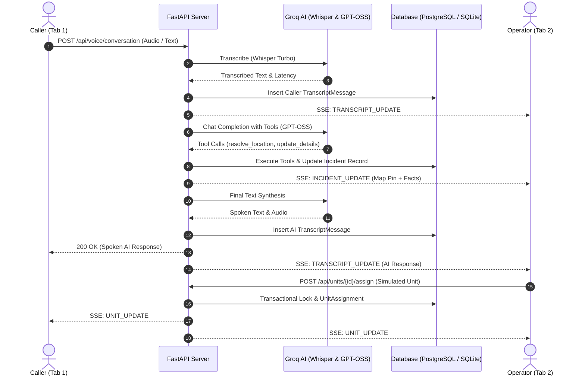

# ResponseOS — Architecture & Engineering Specification

## 1. System Overview

ResponseOS is engineered as a lean, resilient, single-container distributed application:
- **Client Layer:** Single Page Application (React 18, TypeScript, Tailwind, Leaflet) delivering two synchronized roles: the Caller Experience and the Operator Command Center.
- **API & Orchestration Layer:** FastAPI application handling REST endpoints, streaming Server-Sent Events, authentication capability tokens, and rate limits.
- **Inference & Voice Engine:** Groq API for sub-second Whisper STT (`whisper-large-v3-turbo`) and bounded tool calling with GPT-OSS (`openai/gpt-oss-20b`).
- **Data & State Layer:** SQLAlchemy 2.0 Async persistence with isolated workspaces, audit logging, and transactional unit reservations.

---

## 2. Real-Time Synchronization Architecture

The core product demonstration is the **Two-Tab Experience**:
1. A user opens the Caller experience (`/caller`) in Tab 1.
2. Clicking "Open Paired Command Center" opens Tab 2 (`/operator?token=...&role=operator`).
3. Both tabs subscribe to the workspace's event stream at `/api/events/stream`.
4. As the caller speaks into Tab 1:
   - Audio is streamed to Groq Whisper.
   - Groq GPT-OSS reasons and calls `resolve_training_location` and `update_incident_details`.
   - The backend broadcasts `TRANSCRIPT_UPDATE` and `INCIDENT_UPDATE` events over SSE.
   - Tab 2 automatically updates its queue, pins the reported landmark on the Leaflet map with an amber radar pulse, and populates the structured facts table.
5. In Tab 2, when the human operator reviews facts or assigns a simulated training unit:
   - A transactional update locks the unit in the database.
   - The backend broadcasts `UNIT_UPDATE` and `STATUS_CHANGE`.
   - Both browser tabs reflect the updated state.

---

## 3. Data Schema & Models

The system maintains 11 relational entities with foreign keys and index constraints:
1. `TrainingWorkspace`: Isolated training sandbox with unguessable caller and operator capability hashes.
2. `Incident`: Central incident record with category, coordinates, circumstances, hazards, injuries, people affected, missing fields, and state machine enum.
3. `TranscriptMessage`: Immutable record of every spoken or text message with role (`CALLER`, `AI`, `SYSTEM`), audio duration, and latency measurements.
4. `ExtractedField`: Structured key-value facts with confidence tags (`CONFIRMED`, `REPORTED`, `UNCONFIRMED`, `UNKNOWN`) linked to source transcript messages.
5. `OperatorReview`: Human review actions confirming, correcting, or flagging extracted facts.
6. `OperatorNote`: Freeform operational supervisor notes.
7. `TrainingUnit`: Simulated emergency responder fleet (Ambulances, Fire engines, General patrol units).
8. `UnitAssignment`: Transactional assignment records tracking start time and release time.
9. `ToolInvocation`: Audit log of every tool execution, input arguments, output payloads, and execution time.
10. `AuditEvent`: High-level operational timeline events.
11. `UsageLimit`: Workspace-level rate limiting and inference quotas.

---

## 4. Incident State Machine

Incidents follow a deterministic progression enforced on the server:
- `NEW`: Initial call initiated.
- `INFORMATION_COLLECTION`: Caller is actively reporting facts; AI is collecting missing details and resolving landmark coordinates.
- `AWAITING_OPERATOR_REVIEW`: AI has prepared the handoff summary; operator is prompted to verify extracted facts.
- `REVIEWED`: Human operator has confirmed or corrected facts.
- `TRAINING_UNIT_ASSIGNED`: One or more simulated training units have been dispatched.
- `CLOSED`: Incident resolved; all assigned units released back to available pool.
