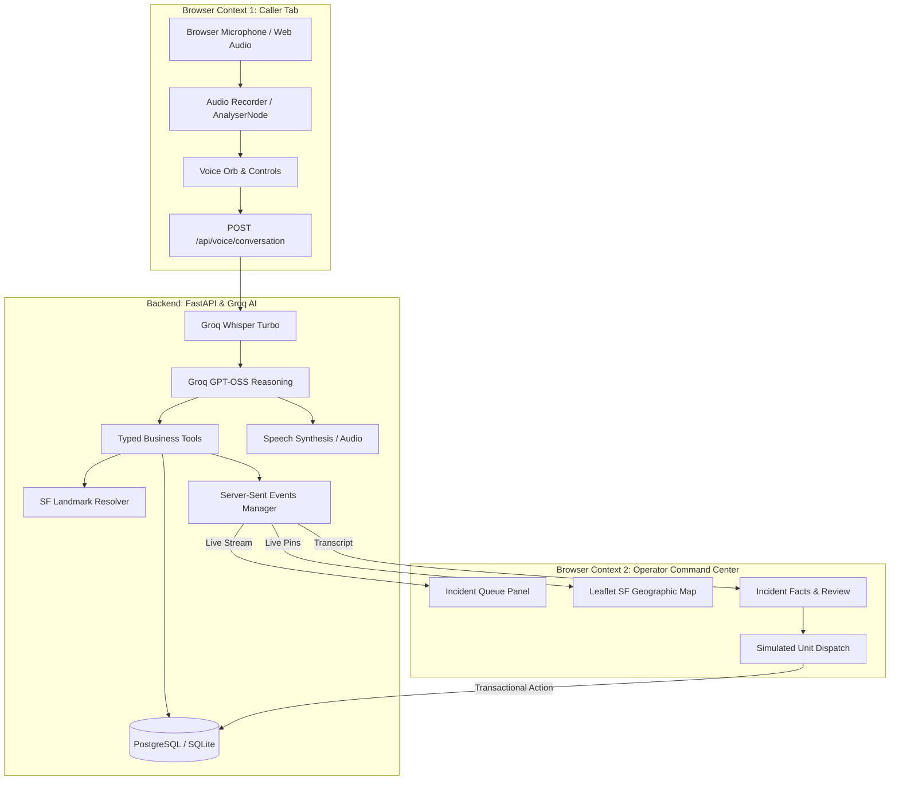

# ResponseOS — "Every second matters."

> **Voice-first AI incident intake and dispatcher training copilot.**  
> Transforms natural caller conversations into structured, actionable intelligence for human emergency operators in real time.

---

## ⚠️ Important Simulation Disclosure
**ResponseOS is a controlled emergency-response TRAINING AND SIMULATION product.**
- It is **not** a real emergency service and does **not** connect to real 911 dispatch networks.
- It never calls emergency telephone numbers, never dispatches real responders, and never provides authoritative medical diagnoses or medical instructions.
- If a user indicates an actual life-threatening emergency during intake, the AI agent immediately halts the simulation and directs them to dial 911 or their local emergency services.
- A human operator reviews all information and makes all response decisions.

---

## 💡 Inspiration & Credits
ResponseOS is an independent, original implementation inspired by the groundbreaking concept of [DispatchAI](https://github.com/IdkwhatImD0ing/DispatchAI) ([Live Demo](https://dispatchai.art3m1s.me/) by [Artemis](https://art3m1s.me/#hero)). We credit the original creators for pioneering the concept of voice AI emergency dispatch copilots. ResponseOS features an original architecture, original codebase, and real-time database transactions.

---

## 🚀 Key Capabilities

1. **Real Microphone Voice Pipeline**
   - Natural browser audio recording via Web Audio API & MediaRecorder.
   - Real-time speech-to-text with **Groq Whisper** (`whisper-large-v3-turbo`) with measured latency under 400ms.
   - Spoken AI responses with transparent fallback to browser speech synthesis when cloud TTS quotas require terms acceptance.

2. **Intelligent Conversational Agent**
   - Adaptive turn-based reasoning powered by **Groq GPT-OSS** (`openai/gpt-oss-20b`).
   - Bounded autonomous tool loop extracting reported circumstances, injuries, and hazards.
   - Real landmark resolution linking San Francisco locations (Ferry Building, Union Square, Golden Gate Bridge, Pier 39, etc.) to verified GPS coordinates.

3. **Live Operator Command Center**
   - 3-panel operations console: Queue, Interactive Leaflet Map, and Incident Intelligence Workstation.
   - Real-time two-tab synchronization powered by Server-Sent Events (SSE).
   - Instant visual pinning of reported incidents on the map with pulsing radar indicators.

4. **Human-in-the-Loop Simulated Dispatch**
   - Deterministic incident state machine (`NEW` → `INFORMATION_COLLECTION` → `AWAITING_OPERATOR_REVIEW` → `REVIEWED` → `TRAINING_UNIT_ASSIGNED` → `CLOSED`).
   - Transactional assignment of simulated response units (Medic-1, Medic-2, Engine-1, Engine-2, Unit-1, Unit-2) with strict availability locking and duplicate prevention.
   - Audit trail tracking every tool execution and operator review action.

5. **Exportable Audit Reports**
   - One-click export of complete training incidents as structured Markdown and raw JSON.

---

## 🏛️ Architecture



---

## 🛠️ Tech Stack

- **Frontend:** React 18, TypeScript, Vite, Tailwind CSS, Lucide Icons, Framer Motion, Leaflet.
- **Backend:** Python 3.11, FastAPI, Pydantic v2, SQLAlchemy 2.0 (Async), Server-Sent Events.
- **AI & Speech:** Groq API (`whisper-large-v3-turbo`, `openai/gpt-oss-20b`), Web Audio API.
- **Database:** PostgreSQL (Neon) / SQLite (Local fallback).
- **Deployment:** Docker, Render Free Web Service.

---

## 🧪 Automated Test Results

ResponseOS includes comprehensive test suites across safety, authorization, and the complete 20-step end-to-end user journey:

```bash
$ python3 -m pytest tests/ -v
============================= test session starts ==============================
tests/backend/test_agent_safety.py::test_real_emergency_interrupt PASSED        [  7%]
tests/backend/test_agent_safety.py::test_prompt_injection_resistance PASSED   [ 15%]
tests/backend/test_location_service.py::test_resolve_exact_landmark PASSED    [ 23%]
tests/backend/test_location_service.py::test_resolve_with_filler_phrases PASSED [ 30%]
tests/backend/test_location_service.py::test_resolve_golden_gate_bridge PASSED [ 38%]
tests/backend/test_location_service.py::test_resolve_oracle_park PASSED        [ 46%]
tests/backend/test_location_service.py::test_resolve_pier_39 PASSED            [ 53%]
tests/backend/test_location_service.py::test_unknown_location_returns_none PASSED [ 61%]
tests/backend/test_location_service.py::test_empty_query_returns_none PASSED   [ 69%]
tests/backend/test_location_service.py::test_catalog_landmarks_count PASSED   [ 76%]
tests/backend/test_tools_executor.py::test_authorization_barrier_rejects_ai_operator_tools PASSED [ 84%]
tests/backend/test_tools_executor.py::test_operator_assign_and_release_unit_lifecycle PASSED [ 92%]
tests/integration/test_e2e_journey.py::test_full_critical_end_to_end_journey PASSED [100%]

============================= 13 passed in 21.83s ==============================
```

---

## ⚡ Local Setup

### 1. Prerequisites
- Python 3.9+
- Node.js 18+
- Groq API Key

### 2. Backend Setup
```bash
cd backend
python3 -m venv venv
source venv/bin/activate
pip install -r requirements.txt
cp ../.env.example .env
# Edit .env with your GROQ_API_KEY
uvicorn app.main:app --reload --port 8000
```

### 3. Frontend Setup
```bash
cd frontend
npm install
npm run dev
```
Open `http://localhost:3000` to view the app in development mode with hot reloading.

---

## 🌐 Production Deployment

The application is containerized with a single multi-stage Dockerfile that builds the React SPA and serves it directly through FastAPI:

```bash
docker build -t responseos .
docker run -p 8000:8000 -e GROQ_API_KEY=gsk_... responseos
```

Deployed live on Render Free Web Service with automatic SSL and zero recurring infrastructure cost.
